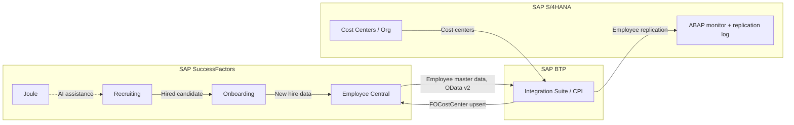

# SAP SuccessFactors Integration Case Study: Alpine Beverage Group

> **Portfolio case study.** Alpine Beverage Group is a **fictional company**. This repository is my own solution design, built to practice SAP SuccessFactors integration, ABAP and SAP Integration Suite in a realistic scenario. It is not a client project and contains no real customer data.

## 📌 Scenario

**Alpine Beverage Group (ABG)** is a fictional beverage bottler with ~25,000 employees in 20 countries. It hires thousands of people every year for production, logistics, field sales and seasonal roles.

**Problem today**
- Recruiting runs in a legacy ATS, core HR runs on SAP ERP HCM on-premise
- New hires are re-typed manually into HR and payroll, which causes errors and delays on day one
- Cost centers and org units in SAP S/4HANA do not match what recruiters see
- Hiring managers wait days for status updates on their requisitions

**Target state**
- **SAP SuccessFactors Recruiting + Onboarding** for the full hiring process
- **SAP SuccessFactors Employee Central** as the HR system of record
- **SAP S/4HANA** stays the system of record for finance (cost centers, company codes)
- **SAP Integration Suite (Cloud Integration / CPI)** connects everything
- **SAP Joule** supports recruiters and hiring managers with AI assistance

## 🏗️ Solution Architecture



Full description: [docs/02-solution-architecture.md](docs/02-solution-architecture.md)

## 🔄 Integration Flows

| ID | Flow | Direction | Technology | Frequency |
|----|------|-----------|------------|-----------|
| INT-01 | Cost center replication | S/4HANA → EC | CPI, OData v2 upsert `FOCostCenter` | Daily delta |
| INT-02 | New hire replication | EC → S/4HANA | CPI, OData v2 `PerPerson` / `EmpJob`, REST to ABAP | Every 15 min |
| INT-03 | Requisition status to hiring managers | SF Recruiting → MS Teams | CPI, `JobRequisition` | Hourly |
| INT-04 | Replication monitoring | S/4HANA internal | ABAP report + CDS view | On demand / job |

## 📁 Repository Structure

```
├── docs/
│   ├── 01-business-case.md            Business requirements and user stories
│   ├── 02-solution-architecture.md    Architecture and design decisions
│   ├── 03-field-mapping.md            EC ↔ S/4HANA field mapping
│   ├── 04-test-plan.md                Test cases and go/no-go criteria
│   └── 05-joule-recruiting-use-cases.md  Joule AI and agent use cases
├── integration/
│   ├── iflow-design.md                CPI iFlow design (INT-01, INT-02)
│   ├── groovy/                        CPI Groovy scripts
│   └── odata-samples/                 SuccessFactors OData v2 requests and payloads
└── abap/
    ├── zsf_repl_log.tabl.abap         Replication log table
    ├── zi_sf_replication_log.ddls.abap  CDS view entity
    ├── zcl_sf_repl_log_handler.clas.abap  Logging and status logic
    ├── zcl_sf_repl_log_handler.test.abap  ABAP Unit tests
    ├── zcl_sf_employee_http_handler.clas.abap  REST endpoint called by CPI
    └── zr_sf_repl_monitor.prog.abap   ALV monitor report
```

## 🧠 Skills Demonstrated

- SuccessFactors Recruiting, Onboarding and Employee Central process design
- SAP Integration Suite: iFlow design, Groovy scripting, error handling
- SuccessFactors OData v2 API (query, `$filter`, `$expand`, upsert)
- ABAP: OO-ABAP, CDS view entities, ALV, ABAP Unit
- Business analysis: requirements, user stories, field mapping, test planning
- SAP Joule and AI agents applied to recruitment

## 👤 Author

**Dominik Dzurnak** - Aspiring SAP SuccessFactors Consultant
[LinkedIn](https://www.linkedin.com/in/dominikdzurnak/)
