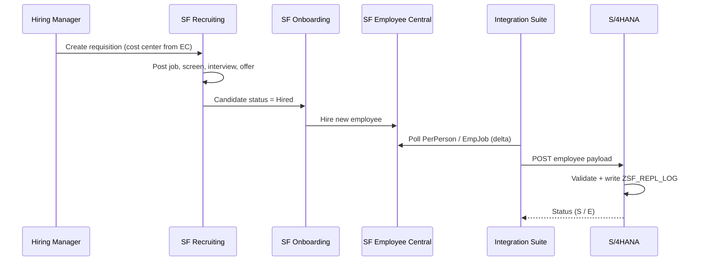

# 02 Solution Architecture

## Systems

| System | Role |
|--------|------|
| SAP SuccessFactors Recruiting | Requisitions, job postings, applications, offers |
| SAP SuccessFactors Onboarding | New hire tasks, data collection before day one |
| SAP SuccessFactors Employee Central | HR system of record (person, employment, job info) |
| SAP Integration Suite (Cloud Integration) | Middleware for all flows |
| SAP S/4HANA | Finance system of record, receives employee data |
| SAP Joule | AI assistant inside SuccessFactors |

## End-to-end hiring flow

## Design decisions

| # | Decision | Reason |
|---|----------|--------|
| D-01 | Use standard Recruiting → Onboarding → EC hire (no custom code) | Standard, upgrade safe |
| D-02 | Cost centers mastered in S/4HANA, replicated to EC | Finance owns the cost center lifecycle |
| D-03 | CPI pulls EC delta via `lastModifiedDateTime` | Simple, restartable, no event setup needed for phase 1 |
| D-04 | Custom ABAP log table + monitor in S/4HANA | HR IT works in S/4HANA, needs reprocessing view |
| D-05 | Phase 2: switch INT-02 to SuccessFactors Intelligent Services events | Near real time once volumes are known |
| D-06 | Joule used only with human approval for candidate decisions | Fairness, GDPR, EU AI Act (recruitment is high risk) |

## Error handling

- CPI: exception subprocess writes error to message log and sends an alert mail to HR IT.
- S/4HANA: each record gets status `S` (success), `E` (error) or `R` (reprocessed) in `ZSF_REPL_LOG`.
- Records in error longer than 24 h are highlighted in the monitor report.

## Security

- CPI → SuccessFactors: OAuth 2.0 SAML bearer assertion, technical API user with minimal RBP permissions.
- CPI → S/4HANA: Cloud Connector, client certificate.
- Only employee ID, names, org assignment and dates are replicated; no bank or health data in this flow.
