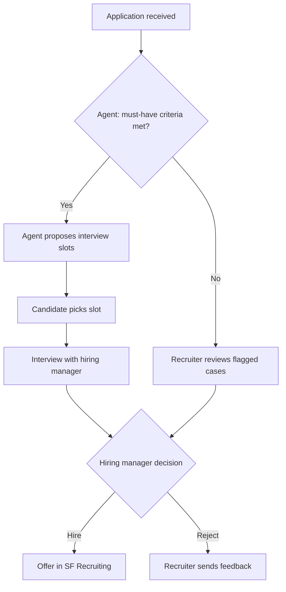

# 05 Joule and AI Agents in Recruiting

How Alpine Beverage Group (fictional) could use SAP Joule and AI agents on top of SuccessFactors Recruiting. Principle: **AI assists, humans decide.** Recruitment is a high risk use case under the EU AI Act, so every hiring decision stays with a person.

## Use cases

| # | Use case | User | Type | Value |
|---|----------|------|------|-------|
| J-01 | Draft a job description from a short brief | Recruiter | Joule assistant | Faster job posting |
| J-02 | Summarize a candidate profile and application | Recruiter, hiring manager | Joule assistant | Faster review |
| J-03 | "Show my open requisitions and their status" | Hiring manager | Joule navigational / transactional | Less chasing |
| J-04 | Suggest interview questions for a role | Hiring manager | Joule assistant | Structured interviews |
| J-05 | Pre-screen seasonal applications against must-have criteria (license, availability, location) | Recruiter | AI agent | Handle spring peak |
| J-06 | Schedule interviews and send reminders | Candidate, recruiter | AI agent | Less admin |
| J-07 | Answer candidate FAQs (shift times, location, benefits) | Candidate | AI agent | 24/7 response |

## Autonomous recruitment flow for seasonal hiring (J-05 to J-07)

## Guardrails

- Agent never rejects a candidate on its own; unclear or negative cases go to a recruiter.
- Criteria are objective and documented (driving license, availability dates, work permit).
- Candidates are informed that AI supports the process.
- All agent actions are logged and auditable.
- Regular bias review of pre-screening results by HR.
